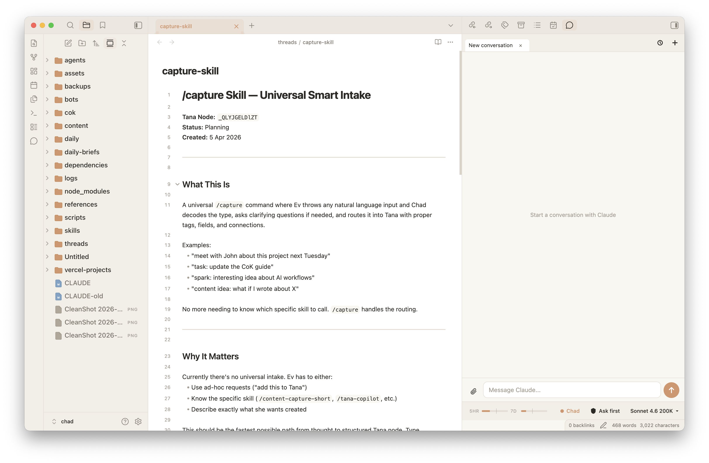

# Hyo — Claude Code Agent

**The power of Claude Code — without the terminal.**



If you want to use Claude Code inside Obsidian but the terminal isn't your thing, Hyo gives you everything Claude Code can do — full agent capability, MCP tools, multi-step reasoning — wrapped in a clean chat interface right inside your notes.

No separate app, no extra billing — Hyo runs on your existing Claude login, not a pay-per-use API key. Just Claude, living in your vault.

---

## Features

- **Multiple conversation tabs** — run parallel conversations or keep different projects separate
- **Past sessions browser** — pick up any previous conversation right where you left off
- **Usage tracking** — see how much of your Claude plan you've used (5-hour window + 7-day)
- **Context window display** — visual indicator of how much conversation context is in use
- **Model switcher** — choose between Opus, Sonnet, and Haiku; 200K or 1M context
- **Permission modes** — control what Claude can do: ask every time, auto-edit, or hands-off
- **Slash commands** — load skills, compact your conversation, and more
- **File attachments** — attach the file you're currently editing with one click, or any text/image file
- **Inline permission prompts** — approve or deny Claude's tool requests without leaving the chat
- **Markdown rendering** — Claude's responses render as rich markdown, not raw text

---

→ **[Full setup guide with Claude Desktop install prompt](SETUP.md)**

---

## Requirements

- [Obsidian](https://obsidian.md) (desktop only)
- A Claude account — Pro, Max, Team, or Enterprise ([claude.ai](https://claude.ai))
- Claude Code CLI (the plugin will walk you through installing it if needed)

---

## Installation

Hyo is a beta plugin, so it installs via **BRAT** (Beta Reviewers Auto-update Tool).

**Step 1: Install BRAT**
In Obsidian, go to Settings → Community Plugins → Browse, search for "BRAT", install and enable it.

**Step 2: Add Hyo**
Go to Settings → BRAT → Add Beta Plugin, paste in:
```
https://github.com/evielync/hyo-claude-code-obsidian-plugin
```
Click **Add Plugin**.

**Step 3: Enable it**
Go to Settings → Community Plugins, find **Hyo Claude Code Agent**, and enable it.

**Step 4: Open Hyo**
Click the chat icon in the ribbon, or run **Hyo Claude Code Agent: Open chat panel** from the command palette. To open it with a shortcut, assign one in Settings → Hotkeys. If Claude Code isn't installed yet, the plugin will show you exactly how to set it up.

---

## How it works

Hyo runs Claude Code CLI as a background process and streams the conversation into Obsidian. Your vault root is Claude's working directory by default — so Claude can read and edit your notes, run tools, and use any MCP servers you've configured.

If your Claude project lives in a different folder, you can point Hyo there: Settings → Hyo Claude Code Agent → Advanced → Working directory.

---

## What Hyo accesses, and why

Hyo is a front end for the Claude Code CLI, which runs on your computer. That's why, on desktop, it does things most Obsidian plugins don't. Everything below happens only in the desktop app. On a phone or tablet, Hyo talks to your own computer (see Mobile access) and touches nothing else on the device.

- **Runs programs (`child_process`).** Hyo starts the `claude` CLI and talks to it over standard input and output. It also finds and updates the CLI (`claude --version`, `claude update`), opens the Claude sign-in, and, only if you turn on mobile access, runs the `tailscale` CLI to make your computer reachable from your phone.
- **Reads and writes files outside the vault (`fs`).** Hyo reads Claude Code's own files in `~/.claude`: past conversations, so they appear in Hyo's history, plus your skills, agents and settings. It writes Hyo's shared list of open conversations and pins there, and stores mobile access settings in `~/.hyo`. Inside your vault, notes are read and written through Obsidian's API.
- **Reads your user name and environment.** Hyo uses your home folder, `PATH` and shell to find the `claude` CLI where your terminal would. On a Mac, it reads your user name to look up Claude Code's sign-in in the Keychain (`security find-generic-password`) for the usage meter. Nothing is fingerprinted or sent anywhere.
- **Opens a local network port (`net`), only if you turn on mobile access.** The gateway listens on `127.0.0.1` only, and Tailscale carries it privately to your phone. It's off by default.
- **Lists vault files.** This feeds the note picker and finds the notes that note commands apply to.
- **Uses the clipboard.** Hyo only writes to it, when you click a copy button. It never reads it.
- **Keeps device-local state in `localStorage`.** Your open tabs on the phone are cached for offline start-up. A one-time move of open tabs from older versions of Hyo also reads it. Settings that belong to one device use Obsidian's own device storage.

## Network use & privacy

Hyo connects to these services and nothing else:

- **Anthropic (Claude).** The Claude Code CLI connects to Anthropic with your existing Claude login. Your messages, and any vault content you choose to share, go to Anthropic under your own account, subject to [Anthropic's terms](https://www.anthropic.com/legal). Hyo reads your usage from Anthropic's API (`api.anthropic.com`) for the usage meter, refreshing the CLI's sign-in token (`claude.ai`) when it has expired.
- **Claude Code installer (`claude.ai`).** Only when you click Install, to download the official CLI installer.
- **OpenAI (optional voice).** Off by default. If you choose GPT-Live voice or OpenAI dictation, your microphone audio and the conversation are sent to OpenAI with an API key you provide.
- **ElevenLabs (optional voice).** Off by default. If you turn it on, your microphone audio and message text are sent to ElevenLabs for speech-to-text and text-to-speech, using an API key you provide.
- **GitHub.** The first time you use voice mode, Hyo downloads its speech-detection models and the runtime that runs them (about 50 MB) from this plugin's own GitHub releases, and keeps them in the plugin folder.
- **Your own computer (optional mobile access).** The phone connects to your computer through your private Tailscale network. Nothing goes through a Hyo server, because there isn't one.
- **No telemetry.** Hyo collects no analytics and sends nothing anywhere else.

Your API keys and settings are stored locally, in the plugin's data or on your computer, and are only ever sent to the service they belong to.

---

## Built by

[Ev Chapman](https://evchapman.com) — teaching knowledge workers to build in partnership with AI.

Part of the [College of Knowledge](https://evchapman.com/cok) community.
